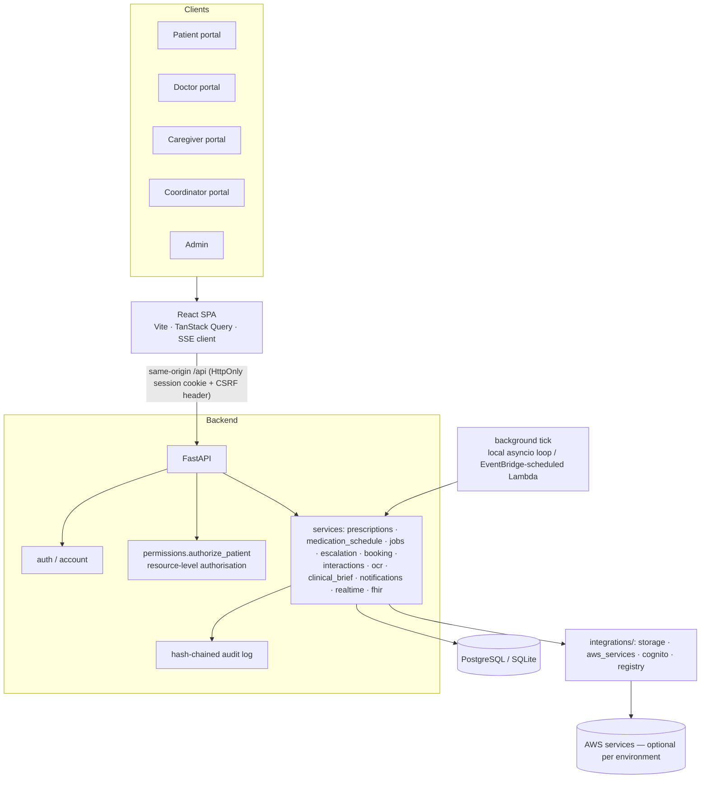

# IMPULSE — Application Architecture

## 1. Overview

## 2. Modules

| Module | Backend | Frontend |
|---|---|---|
| Authentication | `api/auth.py`, `api/account.py`, `integrations/cognito.py`, `core/security.py`, `core/deps.py` | `pages/auth/*`, `pages/shared/Settings.tsx` |
| Permissions | `services/permissions.py`, `api/care.py`, `models/care.py` | `pages/patient/CareTeam.tsx`, `pages/caregiver/*` |
| Patient management | `api/patients.py` | `pages/patient/*` |
| Doctor management | `api/doctor.py` | `pages/doctor/*` |
| Caregiver management | `api/care.py` | `pages/caregiver/*` |
| Medical records | `api/patients.py` (records, documents, corrections) | `pages/patient/Records.tsx` |
| Prescriptions | `services/prescriptions.py`, `schemas/prescriptions.py` | `features/prescriptions/*` |
| Medication schedules | `services/medication_schedule.py` | `features/doses/DoseCard.tsx` |
| Reminders | `services/jobs.py` | — |
| Appointments | `services/booking.py`, `api/appointments.py` | `features/appointments/BookingWizard.tsx` |
| Notifications | `services/notifications.py` | `pages/shared/Notifications.tsx` |
| Audit logging | `core/audit.py` | `pages/admin/AuditLog.tsx` |
| OCR | `services/ocr.py` | `features/ocr/OcrReview.tsx`, doctor Verification |
| Interaction checking | `services/interactions.py` | `features/prescriptions/InteractionPanel.tsx` |
| Human support | `services/escalation.py`, `api/support.py` | `pages/support/*` |
| Reporting | `medication_schedule.adherence_summary` | `features/adherence/AdherenceCard.tsx`, Reports |

## 3. Key workflows

**Prescription lifecycle.** `PrescriptionItem` (one medicine) holds status; its clinical content is in
immutable `PrescriptionVersion`s. Edits publish version *n+1* (`expected_lock_version` prevents lost
updates → HTTP 409), cancel future unanswered doses of the old version from the effective time, and
re-materialise doses from the new one. Future-dated edits are stored as `scheduled` and promoted by the
background tick. Status transitions are validated against `ITEM_TRANSITIONS`.

**Reminder engine** (`jobs.tick`, every minute, idempotent):
1. lifecycle: scheduled→active, completed at end date, discontinued at effective time;
2. expire grants; release expired slot holds;
3. materialise dose occurrences (unique `(item_id, scheduled_at)`) for active items only;
4. due → reminder (dedupe key `reminder:<occurrence>`), snooze re-reminders, follow-up after N min,
   `unconfirmed` after M min (never "missed");
5. escalation evaluation; appointment reminders; retry failed notifications.

**Escalation** (`EscalationPolicy`, per patient or default): reminder → follow-up → check-in →
caregiver notification *only if the patient approved it* → coordinator case (least-loaded on-duty)
→ staff escalate per procedure. Any patient response closes the escalation.

**Booking.** Slots materialised from weekly rules minus leave. A hold claims capacity with a single
conditional `UPDATE … WHERE booked_count < capacity` (atomic on PostgreSQL and SQLite); holds expire
after 5 minutes. Tested with concurrent requests.

**OCR.** Upload → magic-byte/size validation → image quality check → Textract (if configured) →
Comprehend Medical (if configured) → patient review/transcription → doctor verification → structured
prescription → schedule. Unverified data never creates reminders.

**Interaction checks.** Deterministic checks on IMPULSE data (duplicate ingredient, documented allergy)
always run; drug–drug pairs only from a configured licensed source. Results record which checks ran
and which were unavailable; Step Functions handles follow-up notification when configured.

**Clinical brief.** Deterministic, every line linked to source records, with missing information and
conflicts listed. Optional Bedrock narrative stored separately, labelled unverified, discarded if it
cites anything not in its input.

**Real-time.** Server-sent events (`/api/events/stream`) carry only `{topic, patient_id, ref}` hints,
published **after commit**; clients refetch through authorised endpoints, so revocation is enforced on
the next request. AppSync Events mirrors the same hints when configured.

## 4. Database architecture

PostgreSQL in AWS; SQLite locally. UUID string keys, UTC timestamps (`UTCDateTime` type), JSON for
flexible structured fields. Migrations: Alembic (`backend/migrations`, baseline `0001`).

| Area | Tables |
|---|---|
| Identity | `users`, `patient_profiles`, `doctor_profiles`, `caregiver_profiles`, `support_profiles`, `healthcare_organizations`, `user_sessions`, `auth_tokens`, `security_events` |
| Consent & access | `care_relationships`, `doctor_patient_access`, `consent_records`, `break_glass_access`, `escalation_policies` |
| Clinical | `encounters`, `diagnoses`, `allergies`, `medical_records`, `record_correction_requests`, `uploaded_documents`, `ocr_extractions`, `clinical_briefs` |
| Medication | `medication_catalogue`, `prescriptions`, `prescription_items`, `prescription_versions`, `medication_schedules`, `dose_occurrences`, `medication_events` (append-only), `interaction_assessments`, `interaction_alerts`, `refill_requests` |
| Scheduling | `doctor_availability`, `doctor_leave`, `availability_slots`, `slot_holds`, `appointments` |
| Operations | `notifications` (unique `dedupe_key`), `follow_up_instructions`, `messages`, `escalation_cases`, `support_cases`, `contact_attempts`, `case_notes`, `emergency_alerts`, `audit_logs` (hash chain), `fhir_sync_records`, `idempotency_records` |

Key constraints: unique dose slot per item/time; unique doctor slot per start time; unique version
number per item; unique notification dedupe key; unique medication-event idempotency key; foreign
keys with cascade only from patient-owned rows. Clinical records are never overwritten: corrections
create amendments (`amends_id`) and the original is marked `amended`. Files live in object storage;
the database stores metadata + SHA-256 only.

### Source of truth

| Data | Source of truth | Copies | Sync |
|---|---|---|---|
| Users, permissions, prescriptions, schedules, appointments, records | PostgreSQL | — | — |
| Medication events | PostgreSQL (`medication_events`) | DynamoDB mirror (conditional put, idempotent) | write-through; failures don't block the response |
| FHIR resources | PostgreSQL | HealthLake (one-way) | `fhir_sync_records` content hash; SQL wins; retry ≤ 5 |
| Documents | S3 (private, SSE-KMS) | — | metadata row in `uploaded_documents` |
| Adherence time series | PostgreSQL | Timestream for InfluxDB (analytics only) | best-effort line protocol writes |
| Directory search | PostgreSQL | OpenSearch index | re-index job; search never authoritative |
