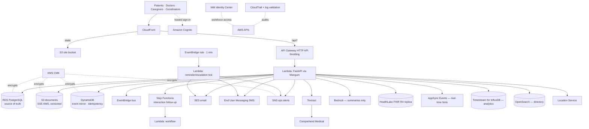

# IMPULSE — AWS Architecture & Integration

Status as of 2026-10-23. **No AWS resources have been deployed from this repository yet**, and no AWS
integration has been tested against a live account. "Implemented" below means the application code
and IaC exist and the local fallback is tested — not that the service is operational.

## 1. Architecture diagram



## 2. Service responsibility matrix

| # | Service | IMPULSE responsibility | Code | IaC | State without config | Phase |
|---|---|---|---|---|---|---|
| 1 | Amazon Cognito | Customer identity: sign-up, verification, MFA (TOTP), recovery; groups describe account type only | `integrations/cognito.py`, `api/auth.py` (`/cognito/*`) | User pool, groups, domain | Local argon2 auth + TOTP + server sessions | 1 |
| 2 | API Gateway | HTTP API entry point, throttling (50 rps / burst 100) | — (infra) | HTTP API + stage | uvicorn directly | 1 |
| 3 | AWS Lambda | API (Mangum), reminder tick, workflow task | `lambda_handler.py` | 3 container functions | normal process + asyncio loop | 1 |
| 4 | DynamoDB | Idempotent medication-event mirror; idempotency records | `aws_services.mirror_medication_event` | 2 tables, PITR, CMK | SQL only | 1 |
| 5 | Amazon S3 | Private documents, versions, access logs; 5-min presigned downloads | `integrations/storage.py` | buckets + logging + lifecycle | private local folder | 1 |
| 6 | AWS KMS | CMK for S3, DynamoDB, RDS, SNS, CloudTrail, logs; rotation on | S3 SSE-KMS key id | Key + policy | local files unencrypted (dev only) | 1 |
| 7 | CloudTrail | AWS API & S3 data-event auditing, file validation | — | multi-region trail | n/a; app audit log always on | 1 |
| 8 | Amazon HealthLake | One-way FHIR R4 replica (Patient, MedicationRequest, AllergyIntolerance, Condition) with provenance tags | `services/fhir.py`, `aws_services.healthlake_put` | optional (`enableHealthLake`) | resources generated, recorded `not_configured` | 2 |
| 9 | AWS AppSync (Events) | Real-time update hints | `aws_services.appsync_publish` | not yet in stack | SSE from FastAPI | 2 |
| 10 | EventBridge | Domain events (PrescriptionCreated/Updated, MedicationDiscontinued, AppointmentBooked, PermissionRevoked…), 1-min schedule, archive, DLQ | `aws_services.publish_event` | bus, rule, archive, SQS DLQ | in-process | 2 |
| 11 | Step Functions | Interaction-assessment follow-up with retries, timeout, failure alert | `start_interaction_workflow`, `interaction_workflow_handler` | state machine | steps run in-process (`orchestrator=local`) | 2 |
| 12 | Amazon SNS | Operational alerts (unassigned cases, break-glass, failures, alarms) | `aws_services.ops_alert` | encrypted topic | server log | 2 |
| 13 | Amazon Pinpoint | **Not used — see §4**; replaced by SES + End User Messaging | — | — | — | 2 |
| 14 | Amazon SES | Email notifications (generic text only) | `send_email` | email identity | `not_configured` | 2 |
| 15 | AWS End User Messaging SMS | SMS notifications (generic text only) | `send_sms` | phone pool set up manually | `not_configured` | 2 |
| 16 | Amazon Textract | OCR of prescription images/PDFs (**addition**: Comprehend Medical cannot read images) | `textract_text` | IAM only | patient transcribes | 3 |
| 17 | Comprehend Medical | Medication entity extraction from OCR text; output is unverified | `comprehend_medications` | IAM only | none | 3 |
| 18 | Amazon Bedrock | Plain-language narrative for clinical briefs; never findings | `bedrock_summarize` (citation validation) | IAM only | deterministic brief only | 3 |
| 19 | Drug interaction source | Licensed knowledge source (HTTP adapter contract in `services/interactions.py`) | `query_knowledge_source` | — | **"unavailable" shown** | 3 |
| 20 | Timestream for InfluxDB | Adherence time-series analytics (not source of truth) | `write_adherence_point` | not yet in stack | SQL aggregation | 3 |
| 21 | OpenSearch | Directory search | `opensearch_query` | optional (`enableOpenSearch`, Serverless) | SQL `ILIKE` | 3 |
| 22 | Location Service | Geocoding "near…" searches | `geocode` | optional (`enableLocation`) | haversine on user-provided coordinates | 3 |
| 23 | IAM Identity Center | Workforce access (developers, admins, support) with least privilege; never patient login | — | optional permission sets | n/a | 1 |

Live status per environment: **Settings → Platform status** (`GET /api/integrations/status`).

## 3. Region & suitability notes (verify before deployment)

- Default region `ap-south-1` (Mumbai) for an Indian launch. HealthLake has been available in Mumbai
  since April 2023 ([AWS](https://aws.amazon.com/about-aws/whats-new/2023/04/amazon-healthlake-asia-pacific-mumbai-region)).
- **Comprehend Medical** is offered only in a few regions (historically US/EU/Sydney/Canada, not Mumbai).
  `COMPREHEND_MEDICAL_REGION` is separate so it can point elsewhere — but sending health text out of
  India is a cross-border transfer requiring legal review under the DPDP framework. Default: off.
- Bedrock model availability differs by region; pick a model available in-region and review data terms.
- All services: confirm HIPAA eligibility / BAA status and Indian law requirements for the actual
  operating context. IMPULSE claims no compliance.

## 4. Requested services that were replaced

| Requested | Status | Replacement | Source |
|---|---|---|---|
| Amazon Pinpoint | Closed to new customers 20 May 2025; **end of support 30 Oct 2026** | SES (email) + AWS End User Messaging (SMS/push), behind `services/notifications.py` | [AWS docs](https://docs.aws.amazon.com/pinpoint/latest/userguide/migrate.html) |
| Timestream for LiveAnalytics | Closed to new customers 20 Jun 2025 | Timestream for InfluxDB (AWS-recommended), analytics only | [AWS docs](https://docs.aws.amazon.com/timestream/latest/developerguide/AmazonTimestreamForLiveAnalytics-availability-change.html) |
| (added) Amazon Textract | — | Needed for OCR; Comprehend Medical only accepts text | — |

## 5. Deployment

```bash
cd infra
python -m venv .venv && .venv\Scripts\activate && pip install -r requirements.txt
npm install -g aws-cdk@2            # CLI
cdk bootstrap aws://<account>/ap-south-1
cdk deploy -c env=dev -c budgetEmail=you@example.com -c sesFromAddress=noreply@yourdomain
# optional, cost while idle: -c enableOpenSearch=true -c enableLocation=true -c enableHealthLake=true
# production requires: -c env=prod -c approvedProd=true
```

After deploy:
1. Run migrations once: invoke the API image with `alembic upgrade head` (or a one-off Lambda/ECS task).
2. Build the SPA (`npm run build`) and `aws s3 sync frontend/dist s3://<SiteBucket>`; invalidate CloudFront.
3. Set the Cognito app client callback to `https://<SiteUrl>/api/auth/cognito/callback` and update `COGNITO_CLIENT_ID/SECRET`, `COGNITO_REDIRECT_URI`.
4. Verify the SES identity and request production access; register an SMS origination identity.
5. Enable GuardDuty Malware Protection for S3 on the documents bucket.
6. Connect a licensed interaction source (`INTERACTION_SOURCE=http`, URL, key in Secrets Manager).
7. Run the integration test checklist (§7) and record results here.

Teardown (dev): `cdk destroy -c env=dev` (dev buckets auto-empty; prod resources are retained).

## 6. Cost assumptions (dev, ap-south-1, low traffic — rough, verify with the AWS Pricing Calculator)

| Item | Assumption | Approx. USD / month |
|---|---|---|
| RDS PostgreSQL db.t4g.micro, 20 GB, 7-day backups | always on | 15–20 |
| Interface VPC endpoints (3 × 2 AZ) | always on | 40–50 |
| NAT gateway | prod only | 0 dev / 35+ prod |
| Lambda + API Gateway | < 1M requests; 43k worker ticks | < 5 |
| DynamoDB on-demand, S3, KMS (1 CMK), SNS, CloudTrail (1 trail) | low volume | 5–10 |
| CloudWatch logs/alarms | 1-month retention | 3–8 |
| Optional: OpenSearch Serverless | minimum OCUs | **~175+** |
| Optional: HealthLake data store | per hour + storage | **~200+** |
| Optional: Textract / Comprehend Medical / Bedrock | per page / per character / per token | usage-based |

Not every service has a free tier. Budget alert at 80 % of `budgetUsd` (default 150). Destroy idle
optional resources; prefer `cdk destroy` for unused dev stacks.

## 7. Integration test results

| Test | Result |
|---|---|
| Local fallbacks for all 23 services (unit/API tests) | **Pass** (26 backend tests) |
| `cdk synth` of the stack (aws-cdk-lib 2.173.2, placeholder account) | **Pass** — 106 CloudFormation resources; not deployed |
| Cognito auth, API Gateway authorisation, Lambda workflows, HealthLake, DynamoDB, S3, Step Functions, Bedrock, Comprehend Medical, interaction source, AppSync, Timestream, SNS/SES/SMS, EventBridge, Location, OpenSearch, KMS, CloudTrail, Identity Center | **Not run — no AWS account/credentials available in development** |

Required live tests (each with failure, missing credentials, expired session, unauthorised request,
duplicate event, concurrent update, retry, failed notification, revoked permission and sync failure
cases) are listed in [PRODUCTION_READINESS.md](PRODUCTION_READINESS.md).

## 8. Services requiring credentials / configuration

Cognito (pool, client id/secret, domain) · S3 bucket · KMS key · DynamoDB tables · EventBridge bus ·
Step Functions ARN · SNS topic · SES verified sender · End User Messaging origination identity ·
HealthLake endpoint · AppSync Events endpoint + key · Textract (IAM) · Comprehend Medical region ·
Bedrock model id · Timestream for InfluxDB URL + token · OpenSearch endpoint · Location place index ·
**licensed drug-interaction provider** · RDS secret. All are listed in `backend/.env.example`.

## 9. Incomplete integrations & known limitations

- No live AWS testing (above). AppSync Events API and Timestream for InfluxDB are not yet in the CDK stack.
- Cognito flow covers hosted-UI sign-in; Cognito-side MFA enforcement for staff groups must be set per policy; local-auth MFA is enforced in-app.
- OpenSearch indexing job (SQL → index) is not written; search falls back to SQL.
- Medicine availability: no pharmacy stock integration — never displayed.
- Medication education content: no reviewed source connected — patients see "not available".
- Push notifications (mobile) not implemented; browser notifications carry no medical detail.
- Video consultations not implemented ("join" disabled).
- Interface translations for Kannada/Hindi/Telugu/Tamil are partial and await professional review.
- Legally authorised representative workflows are modelled (`is_legal_representative`) but not built.
